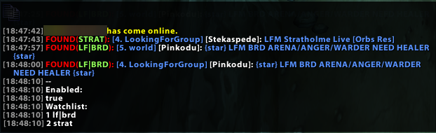
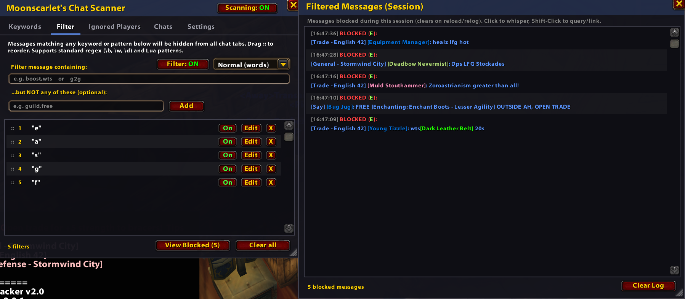
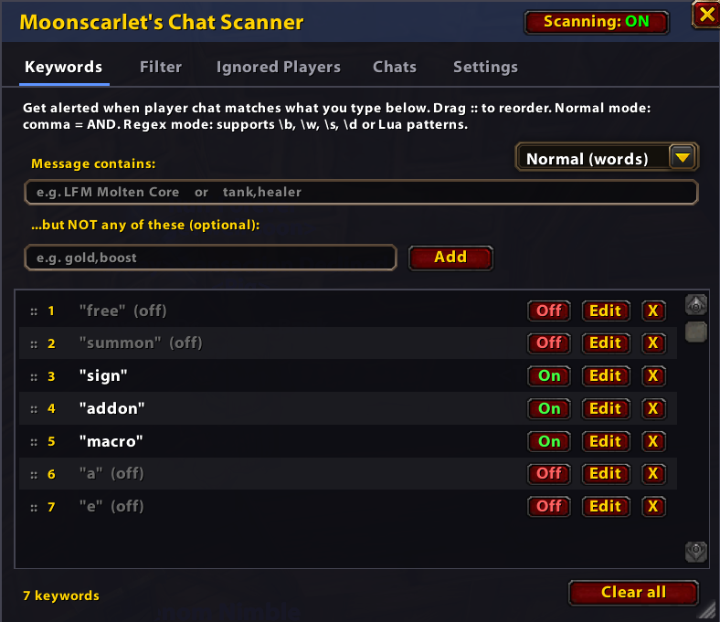
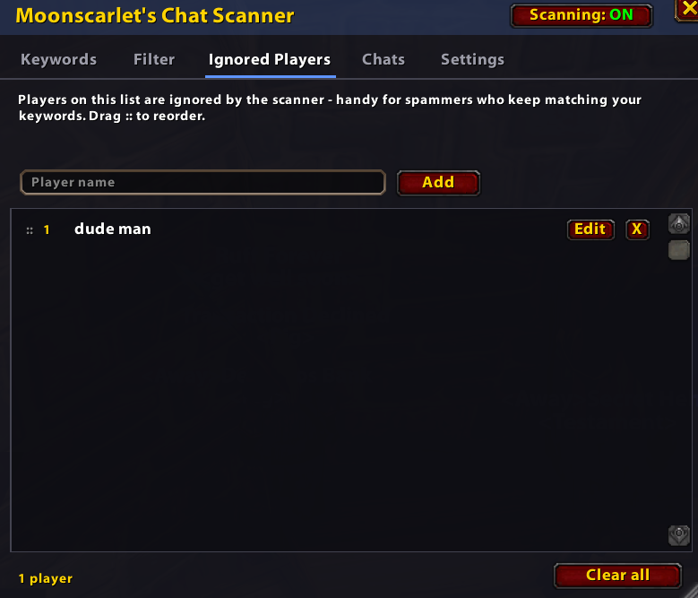
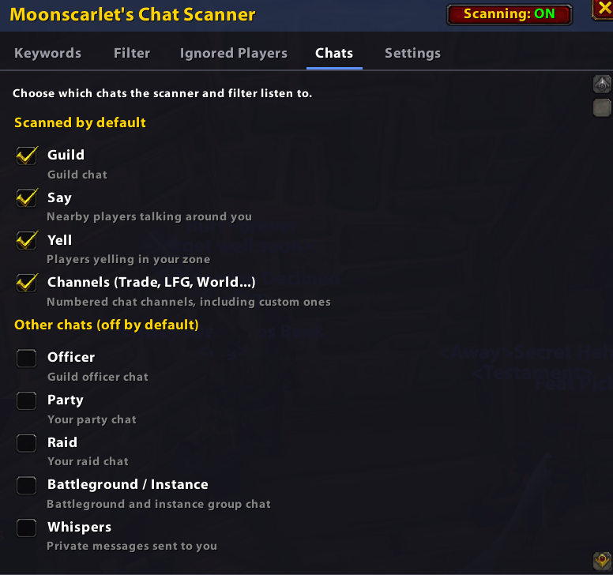
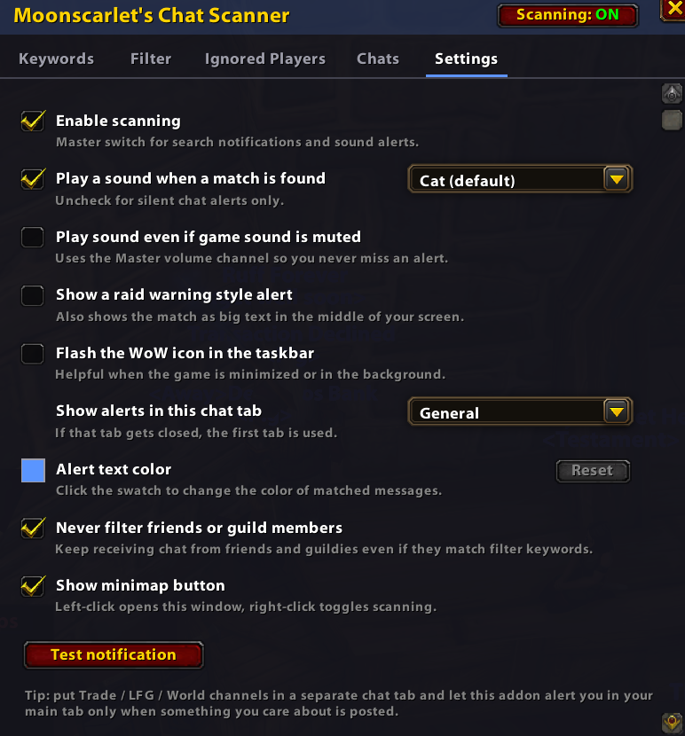

# Moonscarlet's Chat Scanner

A World of Warcraft addon that watches chat for the words you care about and alerts you when they appear. It also features a built-in Chat Filter to hide spam and boost services, full regular expression support, and works seamlessly with heavy channels like Trade, LFG, and World.

## Features

- In-game window (`/cs` or the minimap button) with tabs for Keywords, Filter, Ignored Players, Chats, and Settings
- **Chat Filter:** Block and hide messages matching specific words or patterns from all chat tabs
- **Independent Switches:** Turn scanner alerts on/off without affecting your chat filter, and vice versa
- **Regex Mode:** Match patterns using standard regex (`\b`, `\w`, `\s`, `\d`) or native Lua patterns
- **Blocked Messages Log:** Review filtered messages for the current session (`/cs log` or "View Blocked"), complete with clickable player names to whisper
- Match words or phrases, require several words together, or exclude words
- Manual drag-and-drop (`::`) reordering for keywords, filters, and ignored players
- Exclude friends and guild members from chat filtering (on by default)
- Edit existing keywords and filters in place
- Choose which chats are scanned and filtered:
  - **On by default:** Guild, Say, Yell, Channels
  - **Off by default:** Officer, Party, Raid, Battleground / Instance, Whispers
- Per-player ignore list (separate from the game's own ignore list)
- Choose the alert sound from a list (Cat by default), with an optional "play even if game sound is muted"
- Choose the color of the alert text (the original blue by default)
- Send alerts to any of your chat tabs (the first tab by default)
- Optional raid warning style alert: big text in the middle of the screen (off by default)
- Optional taskbar flash when the game is in the background
- Clickable, class-colored player names in alerts and logs
- Skips your own messages, NPCs, and duplicate messages
- Fully resizable window with scrollable settings and channels
- Settings and lists are saved between sessions

## Installation

1. Download the latest release.
2. Extract the `MoonscarletsChatScanner` folder into `World of Warcraft/_<version>_/Interface/AddOns/`.
3. Restart the game or type `/reload`.

## Usage

Type `/cs` or click the minimap button, then:

1. Open the **Keywords** tab to add words you want alerts for.
2. Open the **Filter** tab (`/cs f`) to add words or phrases you want hidden from chat.
3. Use the Mode dropdown (`Normal` vs `Regex`) if you want pattern matching.
4. Use the **Chats** tab to choose which channels to listen to.
5. Use the **Settings** tab to choose your alert sounds, colors, and preferences.

### Alert settings

All of these are on the **Settings** tab:

| Setting | Default | What it does |
|---|---|---|
| Sound | Cat | Pick from the list next to "Play a sound". Each sound plays when you pick it so you can compare them. |
| Play sound even if game sound is muted | Off | Uses the Master volume channel. |
| Raid warning style alert | Off | Also shows the match as big text in the middle of your screen. |
| Show alerts in this chat tab | First tab | Prints the alert in the chat tab you pick. If that tab gets closed, the first tab is used. The Combat Log can't be picked. |
| Alert text color | Blue | Click the swatch to pick a color; **Reset** brings back the default. |
| Never filter friends or guild members | On | Friends and guildies will never be blocked, even if their message matches a filter rule. |
| Flash the WoW icon in the taskbar | Off | Helpful when the game is minimized or in the background. |

Use **Test notification** to preview your alert settings.

### Rules and Syntax

- **Normal mode:** Separate words with commas to require **all** of them (`tank,dungeon`). Use the second box to exclude words (`gold,boost`). Spaces count exactly as typed.
- **Regex mode:** Write standard regular expressions or Lua patterns (`\b\w+e\w+\b`, `\bboost\b`, `%d+%s*gold`).
- **Drag to reorder:** Click and drag the `::` icon on any row to rearrange your list.

### Slash commands

| Command | Description |
|---|---|
| `/cs` | Open or close the window |
| `/cs f` / `/cs filter [on\|off]` | Open the Filter tab, or turn chat filtering on/off |
| `/cs log` | Open the session's blocked messages log |
| `/cs add [text]` | Add a keyword (`_` = space, `\|` = must match all, `-` = exclude) |
| `/cs addregex [pattern]` | Add a regex keyword |
| `/cs del [number]` | Remove a keyword |
| `/cs toggle [number] ...` | Turn keywords on/off (e.g. `/cs toggle 1 2 3`) |
| `/cs edit [number] [string]` | Replace a keyword (same format as add) |
| `/cs clear` | Clear all keywords |
| `/cs list` | Print keywords, filters, and settings |
| `/cs addplayer [name]` | Ignore a player |
| `/cs delplayer [number]` | Stop ignoring a player |
| `/cs clearplayers` | Clear the ignore list |
| `/cs players` | Print ignored players |
| `/cs enable` / `/cs disable` | Turn scanner alerts on or off |
| `/cs mute` | Toggle notification sound |
| `/cs master` | Play sound even if game sound is muted |
| `/cs flash` | Toggle taskbar flash |
| `/cs help` | Print all commands |

# Screenshots

